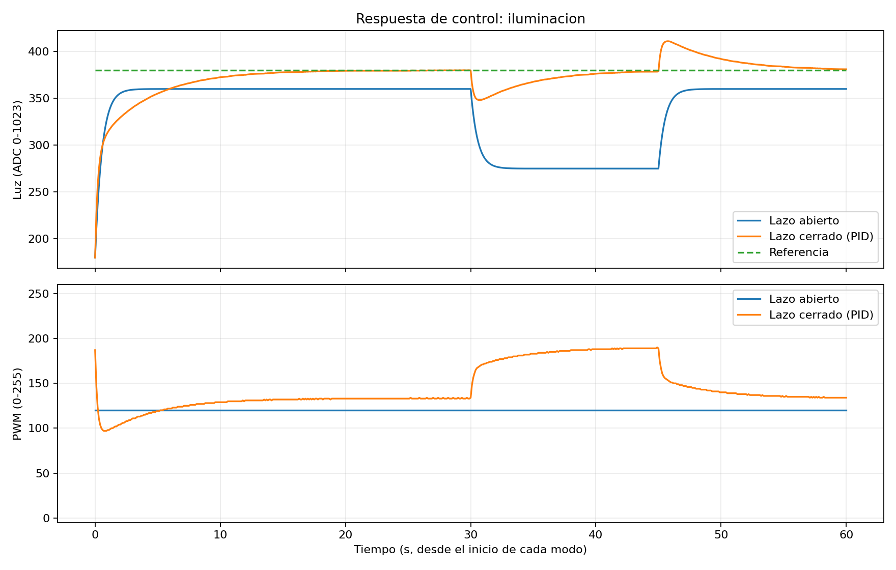

# Semana 10 · Control de iluminación con Arduino: lazo abierto vs. PID

**Ejemplo didáctico · Arquitectura de Computadoras y Ensambladores 2 · Laboratorio S10**

Un **LED** es el actuador, una **fotoresistencia (LDR)** es el sensor y el **Arduino** es el controlador. El objetivo es mantener la luz que mide la LDR cerca de una **referencia**, incluso cuando algo le hace sombra, y comparar ese resultado con dejar el LED a un PWM fijo.

Puedes ejecutar el ejemplo de tres formas, según lo que tengas a mano:

| Opción | Necesitas | Para qué sirve |
|---|---|---|
| [A. Arduino físico](#3-opción-a-arduino-físico-recomendada) | Arduino Uno, LED, LDR, 2 resistencias | Medir un sistema real (lo que se entrega) |
| [B. Wokwi](#5-opción-b-wokwi-sin-arduino-físico) | Solo el navegador | Probar el mismo código sin componentes |
| [C. Python](#6-opción-c-simulación-en-python) | Python 3.10+ | Ver la comparación completa en una gráfica |



> **Importante:** la gráfica sale de un **modelo matemático** (opción C), no de un circuito real. Sirve para saber qué forma esperar; tus mediciones físicas serán más ruidosas y las ganancias PID pueden necesitar ajuste.

## Contenido

| Archivo | Qué contiene |
|---|---|
| [`arduino/ControlIluminacionPID/ControlIluminacionPID.ino`](arduino/ControlIluminacionPID/ControlIluminacionPID.ino) | Firmware para Arduino Uno: lazo abierto, PID y comandos por monitor serie |
| [`wokwi/diagram.json`](wokwi/diagram.json) | Circuito para el simulador Wokwi |
| [`simulacion/simular_pid.py`](simulacion/simular_pid.py) | Simula los dos modos sin hardware y genera un CSV |
| [`simulacion/graficar_csv.py`](simulacion/graficar_csv.py) | Grafica un CSV, venga del simulador o del monitor serie del Arduino |
| [`simulacion/requirements.txt`](simulacion/requirements.txt) | Dependencia para graficar (Matplotlib) |
| [`ejemplo/`](ejemplo/) | CSV y gráfica **simulados** que produce la opción C, como referencia |

## 1. Qué se aprende

- Reconocer un sistema de control **SISO**: una entrada que manipulamos (PWM del LED) y una salida que medimos (luz en la LDR).
- Diferenciar **lazo abierto** (PWM constante, sin mirar el sensor) de **lazo cerrado** (el PWM se calcula a partir de lo que mide el sensor).
- Implementar los términos **P, I y D** con un muestreo de **100 ms**.
- Observar cómo responde cada modo ante una **sombra** (perturbación) sobre la LDR.
- Registrar **10 muestras por modo** de referencia, luz y PWM, como pide la actividad.

## 2. Conceptos antes de empezar

### Lazo abierto

El Arduino escribe siempre el mismo PWM. No lee la LDR para decidir nada, así que si alguien tapa el sensor la luz baja y **nadie lo corrige**.

```text
 PWM fijo ──► [ LED ] ──► luz ──► (LDR solo observa)
```

### Lazo cerrado (realimentación)

Cada 100 ms el Arduino lee la LDR, la compara con la referencia y ajusta el PWM. Si la luz baja por una sombra, el error crece y el PID **sube el PWM** para compensar.

```text
                 error                 PWM              luz
 referencia ──►(+)───►[ PID ]──────►[ LED ]───────┬────► 
               (-)                                  │
                ▲                                   │
                └──────────[ LDR → A0 ]◄────────────┘
                              (medición)
```

### Qué hace cada término del PID

Con `error = referencia − luz`:

| Término | Fórmula en el código | Intuición |
|---|---|---|
| **P** proporcional | `p = kp * error` | Corrige en proporción a qué tan lejos estás *ahora*. Solo P suele dejar un pequeño error permanente. |
| **I** integral | `integral += ki * error * dt` | Acumula el error del *pasado*. Mientras quede error, sigue empujando; por eso elimina el error estacionario. |
| **D** derivativo | `d = -kd * derivada_filtrada(luz)` | Mira la *tendencia*: si la luz sube rápido, frena un poco la acción para evitar sobrepasarse. |

```text
PWM = limitar(P + I + D, 0, 255)
```

Detalles del código que vale la pena entender (están comentados en el `.ino`):

- **Derivada de la medición, no del error.** Si se cambia la referencia con `ref`, el error salta de golpe pero la medición no, así que D no produce un pico.
- **Derivada filtrada.** La LDR tiene ruido; derivar ruido da valores enormes. Se suaviza con `0,7 · anterior + 0,3 · nueva`.
- **Anti-windup.** Si el PWM ya está en 255 y aún falta luz, no tiene sentido seguir acumulando integral (después tardaría mucho en "descargarse"). En ese caso la integral se congela.
- **Transferencia suave.** Al pasar de `abierto` a `cerrado`, la integral se inicializa para que el PID arranque con aproximadamente el mismo PWM que había, en vez de dar un salto.
- **`dt` medido.** Se usa el tiempo real entre muestras (`millis()`), que es ~0,1 s.

### Cómo está organizado el sketch

| Función | Qué hace |
|---|---|
| `setup()` | Configura pines y serie a 115200, calibra y muestra la ayuda y la cabecera CSV |
| `loop()` | Lee comandos y, cada `PERIODO_MS` (100 ms), llama a `cicloControl()`. No usa `delay()`, así el muestreo es regular |
| `cicloControl()` | **El corazón del ejemplo:** lee la luz, calcula el error, aplica PID (o PWM fijo) e imprime una línea CSV |
| `leerLuz()` | Devuelve la lectura de A0 (o del modelo virtual si está `sim on`) |
| `calibrarSensor()` | Mide la luz con el LED apagado y al máximo, y pone la referencia al 60 % de ese rango |
| `entrarEnLazoCerrado()` | Activa el PID con transferencia suave |
| `leerComandosSerial()` / `procesarComando()` | Reciben y ejecutan los comandos del monitor serie |

## 3. Opción A: Arduino físico (recomendada)

### Materiales

| Elemento | Cantidad | Función |
|---|---:|---|
| Arduino Uno o compatible | 1 | Controlador |
| LED blanco de 5 mm | 1 | Actuador luminoso |
| Resistencia de **220 Ω** | 1 | Limita la corriente del LED |
| Fotoresistencia LDR (componente suelto) | 1 | Sensor de luz |
| Resistencia de **10 kΩ** | 1 | Divisor de tensión de la LDR |
| Protoboard y cables | Según necesidad | Conexiones |
| Cable USB | 1 | Alimentación y monitor serie |

### Conexiones

**LED** (la pata larga es el ánodo, A):

```text
Arduino D9 (PWM) ── [220 Ω] ──►|── GND
                               A  C
```

**LDR con divisor de tensión:**

```text
5 V ── [LDR] ──┬── Arduino A0
               │
            [10 kΩ]
               │
              GND
```

Con este divisor, **más luz → lectura ADC mayor**. `analogRead(A0)` devuelve de 0 a 1023 y `analogWrite(9, pwm)` recibe de 0 a 255. Las lecturas son niveles relativos, **no lux calibrados**.

**Montaje:** coloca el LED apuntando a la LDR, a 1–2 cm. Si puedes, rodéalos con un tubo de cartón o papel oscuro para reducir la luz ambiente. Para perturbar el sistema, pon un dedo, la mano o una tarjeta entre el LED y la LDR. Si la lectura casi no cambia entre LED apagado y encendido, el controlador no podrá regular.

**Seguridad:** no conectes el LED al pin sin su resistencia de 220 Ω. Trabaja solo con USB y componentes de baja tensión.

### Cargar y ejecutar

1. Abre [Arduino IDE](https://www.arduino.cc/en/software).
2. Abre `arduino/ControlIluminacionPID/ControlIluminacionPID.ino` (la carpeta y el `.ino` deben llamarse igual, ya está así).
3. Selecciona la placa **Arduino Uno** y su puerto.
4. Carga el sketch. **No necesita librerías adicionales.**
5. Abre el **Monitor serie a 115200 baudios** con terminación **Nueva línea** (*New Line*).
6. El programa calibra (verás el LED apagarse y encenderse) y empieza en **lazo abierto con PWM 120**.
7. Escribe `ayuda` para ver los comandos.

Las líneas que empiezan con `#` son mensajes; las demás son datos CSV. Al iniciar verás algo de esta forma (tus números serán distintos):

```text
# Practica S10: lazo abierto y PID de iluminacion
# Calibrando: LED apagado y LED al maximo...
# Calibracion correcta. Referencia: 60% del intervalo medido.
# LED apagado=<min>; LED maximo=<max>; referencia=<ref>
# Comandos disponibles:
...
tiempo_ms,modo,referencia,luz,pwm,error,p,i,d
```

Si aparece `# AVISO: poca respuesta de la LDR al LED`, acerca el sensor al LED, reduce la luz ambiente y escribe `calibrar`. Pedir una referencia que el LED no puede alcanzar hace que el PWM se quede en 255 sin lograrlo.

## 4. Comandos del monitor serie

Escribe un comando por línea y presiona Enter:

| Comando | Efecto |
|---|---|
| `abierto` | PWM fijo, sin usar la lectura para corregir |
| `pwm 120` | Cambia el PWM del modo abierto (`0–255`) |
| `cerrado` | Activa el PID con realimentación |
| `ref 450` | Cambia la referencia en unidades ADC (`0–1023`) |
| `calibrar` | Recalcula la referencia midiendo LED apagado/encendido; vuelve a lazo abierto |
| `estado` | Muestra modo, referencia, PWM abierto y ganancias |
| `sim on` | Usa un modelo de luz virtual en vez de la LDR (pensado para Wokwi) |
| `sombra` / `normal` | Aplica / quita la perturbación del modelo virtual (solo con `sim on`) |
| `sim off` | Vuelve a leer la LDR real; después ejecuta `calibrar` |
| `ayuda` | Lista los comandos |

Las ganancias están al principio del sketch: `kp = 0.90`, `ki = 0.35`, `kd = 0.025`. Son **valores de partida**; para cambiarlas edita esas líneas y vuelve a cargar el sketch.

### Formato de los datos

```csv
tiempo_ms,modo,referencia,luz,pwm,error,p,i,d
```

| Columna | Significado |
|---|---|
| `tiempo_ms` | Milisegundos desde que arrancó el Arduino |
| `modo` | `0` = lazo abierto, `1` = lazo cerrado |
| `referencia`, `luz` | Unidades ADC (0–1023) |
| `pwm` | Ciclo útil aplicado al LED (0–255) |
| `error` | `referencia − luz` |
| `p`, `i`, `d` | Aporte de cada término del PID, en unidades de PWM (valen 0 en lazo abierto) |

## 5. Opción B: Wokwi (sin Arduino físico)

1. Abre un proyecto nuevo de **Arduino Uno** en [Wokwi](https://wokwi.com/projects/new/arduino-uno).
2. En la pestaña `diagram.json`, reemplaza todo por el contenido de [`wokwi/diagram.json`](wokwi/diagram.json).
3. En la pestaña `sketch.ino`, pega el contenido de [`ControlIluminacionPID.ino`](arduino/ControlIluminacionPID/ControlIluminacionPID.ino).
4. Inicia la simulación y escribe en el monitor serie, uno a uno, esperando unos segundos entre cada comando para ver el efecto:

```text
sim on
sombra
normal
cerrado
sombra
normal
```

**¿Por qué hace falta `sim on`?** En Wokwi el LED y la LDR son componentes independientes: encender el LED **no ilumina** la LDR del simulador. `sim on` reemplaza solo la lectura del sensor por una **planta virtual** de primer orden (luz ambiente + aporte del LED − sombra). El PID que se ejecuta es exactamente el mismo que en el Arduino real.

Con `sim on` puedes predecir los números y comprobarlos en la salida:

| Situación | Qué deberías ver |
|---|---|
| Referencia tras `sim on` | `410` |
| Abierto, PWM 120, sin sombra | `luz` ≈ 360 (180 ambiente + 1,5 × 120) |
| Abierto, con `sombra` | `luz` baja a ≈ 275 y **el PWM sigue en 120** |
| Cerrado, sin sombra | `luz` se acerca a 410 con `pwm` ≈ 153 |
| Cerrado, con `sombra` | `luz` cae un momento y vuelve a ≈ 410; `pwm` sube a ≈ 210 |

Si quieres explorar el módulo LDR de Wokwi moviendo su control de lux, usa `sim off` y cambia `LDR_INVERTIDA = true` al inicio del sketch, porque ese módulo da lecturas mayores en la oscuridad. Aun así, el LED no afectará a esa LDR.

## 6. Opción C: Simulación en Python

Requiere **Python 3.10 o superior**. Todos los comandos se ejecutan **desde esta carpeta** (`Semana_10_PID/`). En Windows, si `python` no funciona, usa `py`.

Generar el CSV no necesita instalar nada:

```bash
python simulacion/simular_pid.py --salida resultados/simulacion.csv
```

Salida esperada:

```text
CSV generado: resultados/simulacion.csv
Error absoluto medio (40-45 s, bajo sombra):
  Abierto: 105.0 unidades ADC
  Cerrado: 2.3 unidades ADC
Los resultados corresponden a un modelo didactico, no a medidas fisicas.
```

Para la gráfica sí hace falta Matplotlib:

```bash
python -m pip install -r simulacion/requirements.txt
python simulacion/graficar_csv.py resultados/simulacion.csv --salida resultados/grafica.png
```

El resultado debe coincidir con `ejemplo/grafica_simulada.png`.

**Qué simula:** la misma planta virtual que `sim on` y el mismo PID del sketch, durante 60 s, con una sombra entre los **segundos 30 y 45**. Ambos modos reciben la misma perturbación para que la comparación sea justa. La referencia está fija en `REFERENCIA = 380` al inicio del script (en Wokwi es 410 porque la calcula la calibración).

**Para experimentar**, edita los valores en `simular_pid.py` (`kp`, `ki`, `kd` en la clase `PID`, `ganancia_led` en `PlantaIluminacion`, o el `-85.0` de la sombra) y compara tiempo de establecimiento, sobreimpulso y error estacionario. Por ejemplo, prueba `ki = 0` y observa cómo queda un error permanente. Un buen resultado en el modelo **no garantiza** el mismo comportamiento en el circuito real.

## 7. Práctica guiada: comparar abierto y cerrado

1. **Lazo abierto:** envía `abierto` y `pwm 120`. Espera a que la lectura se estabilice. Aplica una sombra a la LDR y registra 10 filas. Observa que la columna `pwm` **no cambia**.
2. **Lazo cerrado:** retira la sombra y envía `cerrado`. Espera a que se estabilice. Aplica una sombra parecida y registra otras 10 filas. Observa si el `pwm` **sube** para compensar.
3. **Interpretación:** compara el `error` de ambos modos y analiza qué pasa si el PWM llega a 0 o a 255. ¿La referencia era alcanzable? ¿Qué limitaciones observaste?

### Graficar tus propias mediciones

1. En Arduino IDE, desactiva la marca de hora del monitor serie (botón del reloj), porque agrega texto al inicio de cada línea.
2. Haz la prueba completa: primero lazo abierto, luego lazo cerrado (una vez cada uno).
3. Selecciona todo el texto del monitor serie (Ctrl+A, Ctrl+C) y pégalo en un archivo nuevo `resultados/arduino.csv`. Puedes pegar todo: las líneas con `#` se ignoran, pero debe estar la cabecera `tiempo_ms,modo,...`.
4. Ejecuta:

```bash
python -m pip install -r simulacion/requirements.txt
python simulacion/graficar_csv.py resultados/arduino.csv --salida resultados/arduino.png
```

Cada modo se dibuja desde su propio inicio (t = 0), para que las dos pruebas se puedan superponer aunque se hayan hecho una después de otra.

## 8. Evidencias y entrega de la actividad S10

La guía del laboratorio pide: **código `.ino` comentado**, foto o captura del circuito, **10 muestras por modo** (`referencia`, `luz`, `pwm`), gráfica o registro serial, explicación de sensor / actuador / realimentación / PID y una conclusión comparando ambos lazos ante perturbaciones.

Usa este ejemplo como **referencia**, pero entrega **tus propias mediciones**. Los archivos de `ejemplo/` son simulados y no deben presentarse como lecturas experimentales.

Una buena conclusión responde: ¿el PWM se mantuvo constante en lazo abierto? ¿El PID aumentó la acción al disminuir la luz? ¿Recuperó la referencia? ¿Qué limitaciones viste (saturación, luz ambiente, ruido, posición de la LDR)?

## 9. Diagnóstico rápido

| Síntoma | Qué revisar |
|---|---|
| El LED no enciende | Polaridad (pata larga = ánodo), resistencia, GND, pin D9 |
| `luz` casi no cambia con el LED | Sensor lejos del LED, mucha luz ambiente, divisor mal conectado |
| La luz baja cuando el PWM sube | Divisor invertido; revisa conexiones o `LDR_INVERTIDA` |
| El PWM se queda en 255 sin alcanzar la referencia | Referencia inalcanzable; ejecuta `calibrar` y acerca el sensor |
| El PWM oscila mucho | Baja `kp` o `ki`; reduce `kd` si hay ruido. Cambia un valor a la vez |
| Los comandos no responden | Monitor serie a 115200 y terminación *Nueva línea* |
| Wokwi: el LED no afecta la luz medida | Es normal; usa `sim on` |
| Python: `No module named 'matplotlib'` | `python -m pip install -r simulacion/requirements.txt` (solo para graficar) |

## 10. Referencias

- [Arduino: referencia del lenguaje](https://www.arduino.cc/reference/en/)
- [Arduino IDE 2](https://docs.arduino.cc/software/ide-v2/)
- [Wokwi: fotoresistencia](https://docs.wokwi.com/parts/wokwi-photoresistor-sensor)
- [Wokwi: formato `diagram.json`](https://docs.wokwi.com/diagram-format)
- [NI: explicación de control PID](https://www.ni.com/es/shop/labview/pid-theory-explained.html)
