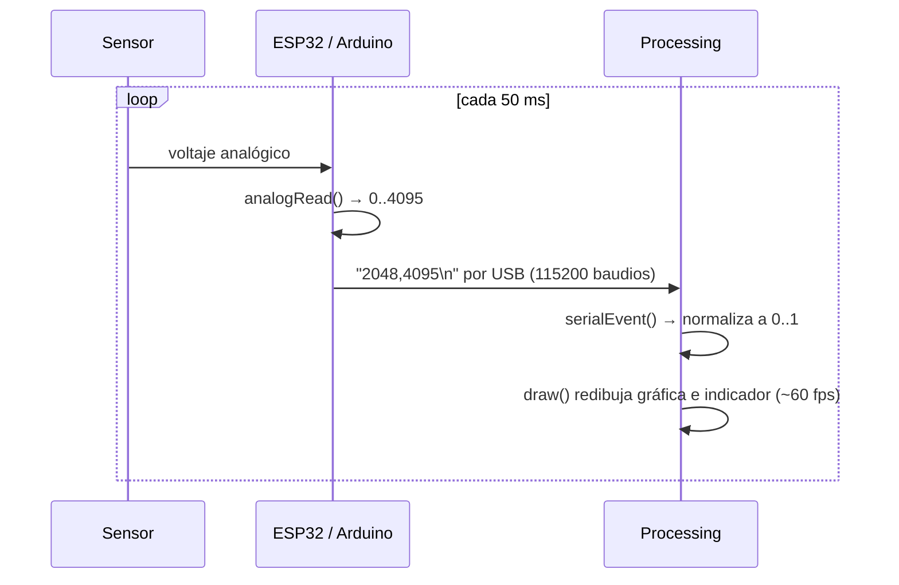
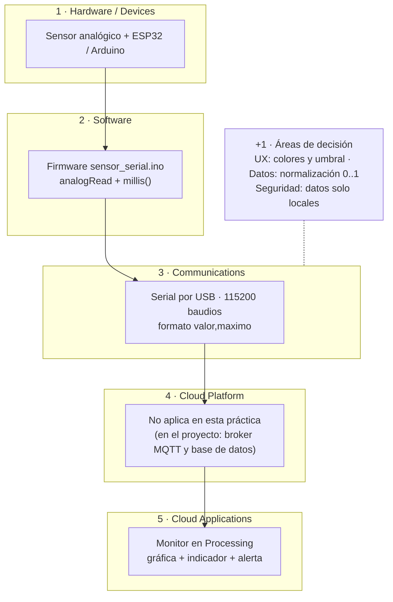

# Semana 4 · Visualización de datos con Processing

Interfaz en Processing que recibe por el puerto serial las lecturas de un sensor conectado a un Arduino o ESP32 y las muestra en tiempo real con una gráfica y un indicador animado. También funciona con datos simulados si no tienes hardware.

**Competencia:** crea componentes y circuitos electrónicos, incluye interfaces visuales mediante prácticas de diseño y monitoreo para generar un prototipo IoT físico funcional.

## Contenido

| Carpeta | Qué contiene |
| --- | --- |
| [`arduino/sensor_serial`](arduino/sensor_serial/sensor_serial.ino) | Firmware que envía `valor,maximo` por serial (lectura real o simulada) |
| [`processing/realtime_monitor`](processing/realtime_monitor/realtime_monitor.pde) | **Actividad 1:** monitor en tiempo real (gráfica + indicador + alerta) |
| [`web/p5-chart`](web/p5-chart/) | **Actividad 2 (optativa):** la misma gráfica en el navegador con p5.js |

## Materiales

- ESP32 o Arduino UNO R4 WiFi y cable USB de datos
- Un sensor analógico: potenciómetro, LDR con resistencia de 10 kΩ o LM35
- [Arduino IDE 2](https://www.arduino.cc/en/software) y [Processing 4](https://processing.org/download) (la librería Serial ya viene incluida)

> Sin hardware: pon `MODO_SIMULADO = true` en el sketch de Processing, o súbelo al Arduino/ESP32 con `MODO_SIMULADO = true` en el `.ino`.

## Conexión

| Sensor | ESP32 | Arduino UNO R4 |
| --- | --- | --- |
| Pin central del potenciómetro / salida del divisor LDR | GPIO 34 | A0 |
| Extremo 1 | 3.3 V | 5 V |
| Extremo 2 | GND | GND |

> El ESP32 trabaja a 3.3 V: no conectes 5 V a sus entradas analógicas.

## Pasos

1. Abre `arduino/sensor_serial/sensor_serial.ino`, selecciona tu placa y puerto, y súbelo.
2. Abre el **Monitor Serie** a 115200 baudios y confirma que llegan líneas como `2048,4095`.
3. **Cierra el Monitor Serie.** Solo un programa puede usar el puerto a la vez.
4. Abre `processing/realtime_monitor/realtime_monitor.pde` y ejecútalo. En la consola aparece la lista de puertos: si el tuyo no es el primero, cambia `INDICE_PUERTO`.
5. Mueve el potenciómetro (o tapa la LDR) y observa la gráfica, el indicador y la alerta al pasar el umbral.
6. Pulsa **S** para guardar una captura y **P** para pausar.

## Cómo funciona



- El firmware usa `millis()` en lugar de `delay()` para no bloquear el programa.
- Enviar también el máximo (`4095` o `1023`) permite normalizar la lectura sin importar la placa.
- `serialEvent()` se ejecuta cada vez que llega un salto de línea; `draw()` solo dibuja el estado actual.
- `lerp()` suaviza el indicador: en cada cuadro avanza un 12 % hacia el valor real.

## Esquema en el IoT Stacked Framework

Parte del entregable: ubicar cada elemento de la solución en su capa.



## Actividad 2 (optativa) · Processing en la web

**¿Cómo se usa Processing en la web?** El proyecto oficial para la web es **[p5.js](https://p5js.org/)**, de la Processing Foundation. Usa el mismo modelo `setup()` / `draw()` y funciones casi iguales (`line()`, `ellipse()`, `map()`, `lerp()`), pero en JavaScript y dentro del navegador. Se puede probar sin instalar nada en el [editor web de p5.js](https://editor.p5js.org/).

Para ejecutar el ejemplo de `web/p5-chart`:

```bash
cd week-04-data-visualization/web/p5-chart
python -m http.server 8000
```

Abre `http://localhost:8000`. Por defecto usa datos simulados. En Chrome o Edge, **Conectar puerto serial** lee el mismo ESP32/Arduino mediante la Web Serial API (cierra antes Processing y el Monitor Serie).

## Entregable

1. Captura del monitor funcionando con datos reales o simulados.
2. Esquema de tu solución en las capas del IoT Stacked Framework (puedes partir del diagrama de arriba).
3. Un párrafo: ¿qué decisión de diseño tomaste para que la visualización se entienda de un vistazo (colores, umbral, escala)?

## Problemas comunes

| Síntoma | Solución |
| --- | --- |
| `Port busy` o no abre el puerto | Cierra el Monitor Serie del Arduino IDE |
| La gráfica no se mueve | Revisa `INDICE_PUERTO` y que los baudios sean 115200 en ambos lados |
| Valores siempre en 0 % o 100 % | Revisa la conexión del sensor y que el pin sea el correcto (34 en ESP32) |
| En Mac/Linux no aparece el puerto | Usa un cable USB de datos, no solo de carga |
