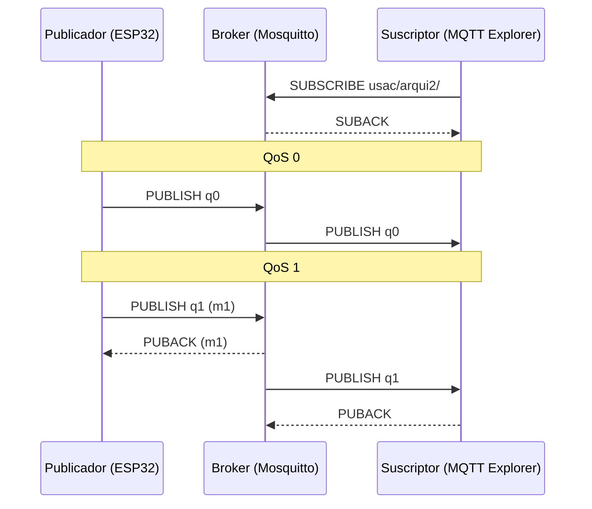

# Semana 5 · Broker MQTT con Mosquitto y niveles de QoS

Levantar un broker MQTT con Mosquitto en Docker, publicar lecturas desde un ESP32 (o un cliente simulado) y verificar su recepción con un suscriptor, comparando QoS 0 y QoS 1.

**Competencia:** relaciona las actividades de proyectos con las capas del stack IoT mediante esquemas, prácticas guiadas y documentación técnica en contextos de diseño modular y conectividad escalable.

> Conserva esta configuración del broker: se reutiliza en el proyecto.

## Contenido

| Carpeta | Qué contiene |
| --- | --- |
| [`broker/`](broker/) | `docker-compose.yml` y `mosquitto.conf` del broker |
| [`esp32/mqtt_publisher`](esp32/mqtt_publisher/mqtt_publisher.ino) | ESP32 que publica lecturas; el QoS se cambia desde el Monitor Serie |
| [`simulator/`](simulator/) | Publicador y suscriptor en Python (si no tienes ESP32) |

## Requisitos

- [Docker Desktop](https://www.docker.com/products/docker-desktop/)
- [MQTT Explorer](https://mqtt-explorer.com/)
- **Con ESP32:** Arduino IDE 2 con la librería **MQTT** de Joel Gaehwiler (se usa en lugar de PubSubClient porque esta solo publica con QoS 0)
- **Sin ESP32:** Python 3.10 o superior y `pip install -r simulator/requirements.txt`

## 1. Levantar el broker

```bash
cd week-05-mqtt/broker
docker compose up -d
docker compose logs -f mosquitto
```

Deja abierta la ventana de logs: la configuración tiene `log_type all`, así que verás cada paquete que pasa por el broker.

Para obtener la IP de tu computadora (la usará el ESP32): `ipconfig` en Windows o `ip addr` en Linux/Mac. El ESP32 y la computadora deben estar en la misma red, y el firewall debe permitir el puerto 1883.

## 2. Suscribirse con MQTT Explorer

1. Nueva conexión: host `localhost`, puerto `1883`, sin usuario.
2. Conecta. MQTT Explorer se suscribe a todos los tópicos (`#`) y muestra el árbol.

También puedes usar el suscriptor de Python, que muestra el QoS con el que llega cada mensaje:

```bash
cd week-05-mqtt/simulator
python subscriber.py --qos 1
```

## 3. Publicar lecturas

**Opción A · ESP32:** en `mqtt_publisher.ino` cambia `WIFI_SSID`, `WIFI_CLAVE`, `BROKER_IP` y el grupo del `TOPICO`. Súbelo y abre el Monitor Serie a 115200. Escribe `0` o `1` para cambiar el QoS.

**Opción B · simulador:**

```bash
python publisher.py --qos 0
python publisher.py --qos 1
```

Los mensajes aparecen en MQTT Explorer bajo `usac/arqui2/...`.

## 4. Comparar QoS 0 y QoS 1

### En los logs del broker

**QoS 0:** el broker recibe y reenvía, sin confirmar a nadie.

```text
Received PUBLISH from sim-pub-9037 (d0, q0, r0, m0, 'usac/arqui2/demo/temperatura', ... (51 bytes))
Sending PUBLISH to auto-2DC8... (d0, q0, r0, m0, 'usac/arqui2/demo/temperatura', ... (51 bytes))
```

**QoS 1:** el broker confirma al publicador con **PUBACK**, y el suscriptor confirma al broker.

```text
Received PUBLISH from sim-pub-2836 (d0, q1, r0, m1, 'usac/arqui2/demo/temperatura', ... (51 bytes))
Sending PUBLISH to auto-2DC8... (d0, q1, r0, m1, 'usac/arqui2/demo/temperatura', ... (51 bytes))
Sending PUBACK to sim-pub-2836 (m1, rc0)
Received PUBACK from auto-2DC8... (Mid: 1, RC:0)
```

Cómo leer los campos: `d` = bandera DUP (reenvío), `q` = QoS, `r` = retain, `m` = identificador del mensaje.

### Experimento: mensajes con el suscriptor desconectado

Aquí la diferencia entre QoS 0 y 1 se ve claramente:

```bash
# 1. Suscríbete con sesión persistente y luego ciérralo con Ctrl+C
python subscriber.py --qos 1 --persist

# 2. Con el suscriptor apagado, publica 3 mensajes de cada tipo
python publisher.py --qos 0 --count 3 --interval 0.2
python publisher.py --qos 1 --count 3 --interval 0.2

# 3. Vuelve a conectar el suscriptor
python subscriber.py --qos 1 --persist
```

Resultado esperado: llegan **solo los 3 mensajes QoS 1**. El broker los guardó en cola porque la sesión es persistente; los de QoS 0 se descartaron.

```text
Conectado (Success) · sesión previa encontrada: True
← usac/arqui2/demo/temperatura · recibido con QoS 1 · n=0 temp=24.17 (publicado con QoS 1)
← usac/arqui2/demo/temperatura · recibido con QoS 1 · n=1 temp=24.55 (publicado con QoS 1)
← usac/arqui2/demo/temperatura · recibido con QoS 1 · n=2 temp=25.13 (publicado con QoS 1)
```

### Extra: la regla del menor

Suscríbete con `--qos 1` y publica con `--qos 2`: el mensaje llega con **QoS 1**, porque el suscriptor recibe el menor entre el QoS publicado y el de su suscripción.

## Flujo publicador → broker → suscriptor



## Entregable

1. Captura de MQTT Explorer recibiendo tus mensajes en tu tópico.
2. Captura de los logs del broker con un mensaje QoS 0 y uno QoS 1.
3. Explicación breve (5–8 líneas) del flujo publicador–broker–suscriptor que observaste: quién confirma a quién en cada nivel y qué pasó en el experimento con el suscriptor desconectado.

## Problemas comunes

| Síntoma | Solución |
| --- | --- |
| El ESP32 no conecta al broker | Usa la IP de la PC (no `localhost`), misma red Wi-Fi, abre el puerto 1883 en el firewall |
| `Connection refused` desde otra PC | Revisa que `mosquitto.conf` tenga `listener 1883` y `allow_anonymous true` |
| El ESP32 imprime `FALLO` con QoS 1 | No llegó el PUBACK a tiempo: revisa la conexión o reinicia el broker |
| No ves paquetes en los logs | Ejecuta `docker compose logs -f mosquitto` dentro de la carpeta `broker` |

> `allow_anonymous true` es solo para el laboratorio. En el proyecto usa usuario y contraseña (`password_file`) o TLS.
