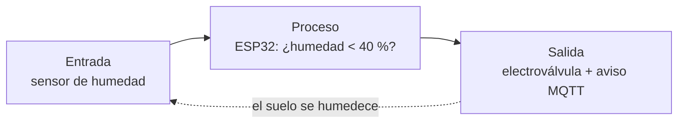

# Ejemplo resuelto · Riego automatizado en un invernadero

> Ejemplo de referencia para mostrar el nivel de detalle esperado. Cada grupo debe analizar un proceso distinto.

**Sector:** agricultura

## 1. El proceso

- **Nombre del proceso:** riego de cultivos en un invernadero pequeño.
- **Antes:** un trabajador revisaba la tierra a mano dos veces al día y abría las válvulas según su experiencia. En días calurosos el riego se retrasaba y en días nublados se regaba de más.
- **Hoy:** sensores de humedad del suelo miden cada pocos minutos. Cuando la humedad baja de un umbral, un microcontrolador abre una electroválvula hasta recuperar el nivel. Los datos se envían a un panel para que el encargado vea el estado del invernadero.

## 2. Entrada → proceso → salida

| Etapa | ¿Qué ocurre? | ¿Con qué se hace? |
| --- | --- | --- |
| Entrada | Se mide la humedad del suelo y la temperatura | Sensores capacitivos de humedad y DHT22 |
| Proceso | Se compara la humedad con el umbral del cultivo | ESP32 con FreeRTOS |
| Salida | Se abre o cierra el agua y se reporta el estado | Electroválvula con relé; mensaje MQTT al panel |

## 3. Tecnologías que lo hacen posible

| Tecnología | ¿Aplica? | ¿Para qué? |
| --- | --- | --- |
| Sistema embebido / microcontrolador | Sí | El ESP32 lee los sensores y controla la válvula |
| RTOS (FreeRTOS, RIOT-OS) | Sí | Tareas separadas: medir, regar y enviar datos sin que una bloquee a otra |
| Raspberry Pi | Sí | Gateway local: corre el broker Mosquitto y el panel en Grafana |
| MicroPython | Opcional | Útil para prototipar rápido la lógica de riego antes de pasarla a C++ |
| Comunicación | Sí | MQTT por Wi-Fi entre el ESP32 y la Raspberry Pi |

## 4. Las personas en el proceso

| Tareas que hace la máquina | Tareas que siguen dependiendo de las personas |
| --- | --- |
| Medir la humedad cada 5 minutos | Elegir el umbral adecuado para cada cultivo |
| Abrir y cerrar el agua | Detectar plagas o enfermedades en las plantas |
| Registrar el historial de riego | Calibrar sensores y reparar fugas |
| Enviar alertas si un sensor falla | Decidir qué hacer ante una alerta |

Siguen siendo humanas porque requieren criterio agronómico, observación directa de las plantas y mantenimiento físico.

## 5. Beneficios y riesgos

| Beneficios | Riesgos |
| --- | --- |
| Ahorro de agua al regar solo cuando hace falta | Un sensor dañado puede inundar o secar el cultivo |
| Riego constante también de noche y fines de semana | Dependencia de la energía y del Wi-Fi |
| Historial de datos para tomar mejores decisiones | Costo inicial y necesidad de capacitación |

## 6. Conclusión

La automatización **apoyó** al trabajador en lugar de reemplazarlo. Eliminó la tarea repetitiva de revisar y abrir válvulas, pero el criterio sobre el cultivo, la calibración y la respuesta a fallas siguen siendo humanos. Su rol pasó de ejecutar el riego a supervisarlo.
