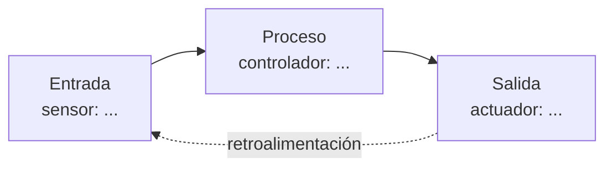

# Análisis de un proceso automatizado

**Grupo:**
**Integrantes:**
**Sector:** industria · agricultura · logística · hogar *(deja solo uno)*

## 1. El proceso

- **Nombre del proceso:**
- **Antes de automatizarse, ¿cómo se hacía?** (quién lo hacía, cuánto tardaba, qué errores había)
- **Hoy, ¿cómo funciona?** (2–4 oraciones)

## 2. Entrada → proceso → salida

| Etapa | ¿Qué ocurre? | ¿Con qué se hace? |
| --- | --- | --- |
| Entrada (sensores) | | |
| Proceso (decisión) | | |
| Salida (actuadores) | | |

## 3. Tecnologías que lo hacen posible

Marca las que aplican y explica en una línea **para qué** se usan en este proceso.

| Tecnología | ¿Aplica? | ¿Para qué? |
| --- | --- | --- |
| Sistema embebido / microcontrolador | | |
| RTOS (FreeRTOS, RIOT-OS) | | |
| Raspberry Pi u otra computadora de placa única | | |
| MicroPython | | |
| Comunicación (MQTT, HTTP, LoRa...) | | |
| Otra: | | |

## 4. Las personas en el proceso

| Tareas que hace la máquina | Tareas que siguen dependiendo de las personas |
| --- | --- |
| | |
| | |

¿Por qué esas tareas siguen siendo humanas? (criterio, supervisión, mantenimiento, trato con personas...)

## 5. Beneficios y riesgos

| Beneficios | Riesgos |
| --- | --- |
| | |
| | |

## 6. Conclusión

En 3–5 líneas: ¿la automatización **reemplazó** o **apoyó** a las personas en este proceso? Justifica con lo que encontraste.

## Fuentes

- 
