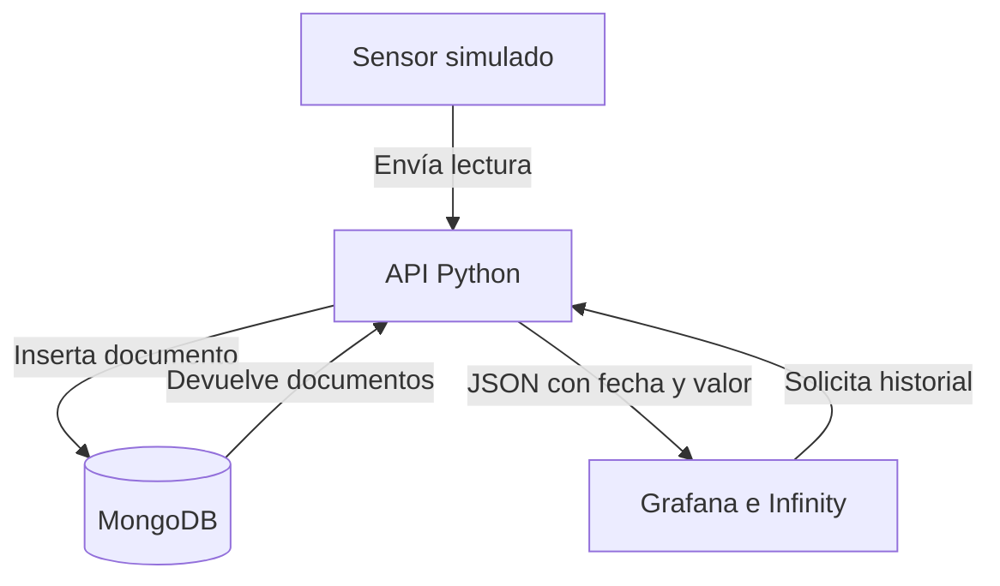

# Semana 7 · Grafana y NoSQL

**Registro y monitoreo de lecturas de temperatura**  
**Autora del material: Wendy Mazariegos**

Un sensor simulado registra la temperatura de un laboratorio cada cinco segundos.
MongoDB almacena cada lectura como un documento. Grafana consulta esos documentos
mediante una API y dibuja su evolución. No necesitas un sensor físico.

## Qué podrás demostrar

- Ver una temperatura generada automáticamente y su fecha de registro.
- Consultar el documento que realmente se guardó en MongoDB.
- Observar la misma lectura como un punto en la gráfica de Grafana.
- Ingresar manualmente **35 °C** y observar el cambio de color desde **30 °C**.
- Añadir un atributo de humedad a un documento para explicar la flexibilidad de NoSQL.

> Los datos son simulados. El umbral de 30 °C es didáctico y solo cambia la
> visualización: este ejemplo no configura notificaciones de correo ni alarmas.

## Cómo funciona



| Componente | Función en el ejemplo |
|---|---|
| Python | Genera el ciclo de temperaturas y valida los datos recibidos. |
| MongoDB | Guarda los documentos BSON con una fecha de tipo Date y un valor numérico. |
| FastAPI | Ofrece las operaciones para registrar y consultar las lecturas. |
| Infinity | Permite que Grafana consulte el JSON de la API. |
| Grafana | Muestra la última lectura, un medidor, el historial y una tabla. |

Se utiliza Grafana OSS con Infinity. El conector MongoDB nativo de Grafana es
Enterprise; para este laboratorio la API permite consultar MongoDB sin ese conector.

## 1. Iniciar el laboratorio

Requisitos: Docker con **Docker Compose v2**, conexión a Internet para descargar
las imágenes y el plugin la primera vez; puertos locales 3000 y 8000 disponibles.
En Windows, inicia Docker Desktop y utiliza contenedores Linux.

Coloca la carpeta **`Semana_7_Grafana_NoSQL`** junto a las demás semanas de tu repositorio.
Descomprime el proyecto, abre una terminal en esa carpeta, donde está `compose.yaml`
y copia la configuración:

**Windows PowerShell:**

```powershell
Copy-Item .env.example .env
```

**Linux o macOS:**

```bash
cp .env.example .env
```

En cualquiera de los sistemas:

```bash
docker compose up -d --build
docker compose ps
```

Espera a que la API esté saludable y Grafana termine de instalar Infinity.
La primera ejecución puede tardar varios minutos.

| Acceso | Dirección / credencial de ejemplo |
|---|---|
| Dashboard | http://localhost:3000/d/temperatura-demo |
| Usuario de Grafana | `wendy` |
| Contraseña de Grafana | `GrafanaDemo2026` |
| API interactiva | http://localhost:8000/docs |
| Lecturas almacenadas | http://localhost:8000/lecturas |
| Salud de la API | http://localhost:8000/health |

Las credenciales están en `.env`. Los puertos se publican solamente en tu equipo
(127.0.0.1); la API del laboratorio no lleva autenticación. Conserva esa configuración
para la demostración local. No subas `.env` al repositorio.

Al iniciar por primera vez, se agregan 30 lecturas de historial simulado.
Después el sensor genera una nueva cada 5 segundos: sube de 24 °C hasta 33 °C
y vuelve a bajar en un ciclo de dos minutos.

## 2. Observar el registro y la gráfica

1. Abre el dashboard y deja el intervalo **Últimos 15 minutos**, con actualización de 5 segundos.
2. Observa el indicador de última temperatura y los puntos del historial.
3. Abre `http://localhost:8000/lecturas?limite=3`: verás los tres documentos más recientes, en orden cronológico.
4. Compara `fecha` y `valor` con la tabla del dashboard. Las fechas de la API están en UTC; el dashboard usa `America/Guatemala` (UTC−6).
5. Consulta el registro del simulador para ver los identificadores MongoDB:

```bash
docker compose logs --tail=10 sensor
```

La gráfica muestra **fecha en el eje X** y **temperatura en °C en el eje Y**.
Grafana no guarda las lecturas: las consulta en MongoDB mediante la API.
La consulta devuelve como máximo las últimas 2,000 lecturas del intervalo, en
orden cronológico. Este es un laboratorio pequeño, sin agregación para grandes volúmenes.

## 3. Crear un cambio visible: de 24 a 35 °C

Pausa temporalmente el sensor para que la lectura manual permanezca como la última:

```bash
docker compose stop sensor
```

Abre `http://localhost:8000/docs`, despliega **POST /lecturas**, pulsa **Try it out**
y sustituye el cuerpo por este JSON. Pulsa **Execute**:

```json
{
  "dispositivo": "sensor-01",
  "valor": 24,
  "ubicacion": "Laboratorio",
  "origen": "demostracion-manual"
}
```

Espera al siguiente refresco del dashboard. Repite con `"valor": 35`.
El punto nuevo subirá a **35 °C**, el indicador cambiará a rojo y la respuesta
JSON mostrará `"estado": "REVISAR"` junto con el `_id` del documento guardado.
Omite `fecha` para usar la hora actual del servidor.

Para demostrar un campo opcional, registra otra lectura:

```json
{
  "dispositivo": "sensor-01",
  "valor": 27,
  "origen": "demostracion-manual",
  "atributos": {"humedad": 68, "observacion": "Ventilación activada"}
}
```

Se guarda un documento con información adicional. Los anteriores siguen siendo válidos.
NoSQL permite documentos flexibles; la API conserva reglas comunes para que todos
puedan graficarse: dispositivo, fecha, temperatura y unidad.

Reanuda el sensor al terminar:

```bash
docker compose start sensor
```

## 4. Ver los documentos directamente en MongoDB

Abre la consola de MongoDB usando las credenciales del contenedor:

```bash
docker compose exec mongodb sh -c 'mongosh --username "$MONGO_INITDB_ROOT_USERNAME" --password "$MONGO_INITDB_ROOT_PASSWORD" --authenticationDatabase admin'
```

Dentro de `mongosh`, ejecuta:

```javascript
use temperaturas
db.lecturas.find().sort({fecha:-1}).limit(3)
db.lecturas.find({valor:{$gte:30}}).sort({fecha:-1}).limit(5)
db.lecturas.find({"atributos.humedad":{$exists:true}})
```

Ejecuta también el archivo con las consultas y el promedio por sensor:

```javascript
load('/ejemplos/consultas.js')
```

Ejemplo de estructura de documento; el identificador y la fecha reales variarán:

```javascript
{
  _id: ObjectId("...") ,
  dispositivo: "sensor-01",
  fecha: ISODate("2026-10-31T18:00:00Z"),
  valor: 35,
  unidad: "°C",
  ubicacion: "Laboratorio",
  origen: "demostracion-manual",
  atributos: {}
}
```

`fecha` se almacena como Date BSON, no como texto; la API la convierte a ISO 8601
para Grafana. `estado` se calcula al responder y no se almacena en el documento.

## 5. Verificar y solucionar problemas

Con el laboratorio iniciado y Python 3.12 o posterior instalado en tu equipo:

```bash
python scripts/verificar_demo.py
```

En algunos sistemas el comando se llama `python3` o `py`.
La verificación registra una lectura de 35 °C, confirma que la API la recupera y
comprueba que la consulta de Grafana a través de Infinity devuelve su identificador.
Esta prueba agrega un documento con origen `verificacion`.

| Problema | Acción |
|---|---|
| Grafana aún no abre | Espera la instalación inicial y consulta `docker compose logs grafana`. |
| Aparece “No data” | Selecciona Últimos 15 minutos; ejecuta `docker compose ps` y consulta `/lecturas`. |
| Falla el plugin | Revisa la conexión a Internet y `docker compose logs grafana`; reinicia con `docker compose restart grafana`. |
| API sin acceso a MongoDB | Revisa `docker compose logs api mongodb` y que `.env` coincida con las credenciales usadas al crear el volumen. |
| La contraseña nueva no funciona | Las credenciales iniciales se aplican al crear los volúmenes; editar `.env` no modifica los usuarios ya guardados. |
| Puerto ocupado | Libera el puerto 3000 u 8000 antes de iniciar el proyecto. |
| No ves la última lectura | Vuelve al intervalo relativo Últimos 15 minutos y verifica que el refresco esté activado. |

Para detener sin borrar los documentos:

```bash
docker compose down
```

Para **borrar todo el historial y la configuración guardada** y empezar de cero:

```bash
docker compose down -v
docker compose up -d --build
```

El dashboard original está en archivos de aprovisionamiento. Para conservar cambios
hechos desde Grafana, expórtalo y reemplaza `grafana/dashboards/temperatura.json`.

## 6. Pruebas del código

Desde la raíz del proyecto, crea un entorno virtual e instala las dependencias:

```bash
python -m venv .venv
```

Actívalo con `.venv\Scripts\Activate.ps1` en PowerShell o `source .venv/bin/activate`
en Linux/macOS. Después:

```bash
python -m pip install -r requirements-dev.txt
python -m pytest -q
```

Las pruebas usan MongoDB simulado en memoria; no reemplazan la verificación con
contenedores. Consulta [el alcance de validación](docs/validacion.md).

## 7. Subir a un repositorio

Si ya tienes el repositorio del curso, agrega la carpeta `Semana_7_Grafana_NoSQL`
junto a `Semana_6_Automatización` y las demás semanas, y haz commit desde la raíz
de ese repositorio. No ejecutes `git init` dentro de la semana en ese caso.

El ZIP incluye el código y las configuraciones. No incluye `.env`, datos personales,
volúmenes de base de datos ni el entorno virtual. Crea un repositorio vacío en tu
cuenta, copia su URL y ejecuta desde esta carpeta:

```bash
git init
git add .
git commit -m "Ejemplo semana 7: temperaturas con MongoDB y Grafana"
git branch -M main
git remote add origin URL_DE_TU_REPOSITORIO
git push -u origin main
```

Sustituye `URL_DE_TU_REPOSITORIO` por la URL real. Estas instrucciones no crean
ni publican un repositorio automáticamente.

## Archivos principales

| Ruta | Contenido |
|---|---|
| `compose.yaml` | MongoDB, API, simulador y Grafana. |
| `app/main.py` | Validación, almacenamiento y consulta de documentos. |
| `app/simulator.py` | Ciclo de temperaturas simuladas. |
| `grafana/dashboards/temperatura.json` | Dashboard listo para importar automáticamente. |
| `mongo/consultas.js` | Consultas NoSQL de la demostración. |
| `scripts/verificar_demo.py` | Verificación del recorrido completo con los servicios activos. |
| `docs/guion_demostracion.md` | Guion de clase de 20 minutos. |
| `tests/test_api.py` | Pruebas automatizadas de los datos y la API. |

## Referencias oficiales

- [MongoDB: conexión con PyMongo](https://www.mongodb.com/docs/languages/python/pymongo-driver/current/connect/)
- [Grafana: MongoDB Enterprise data source](https://grafana.com/docs/plugins/grafana-mongodb-datasource/latest/)
- [Infinity: datos JSON](https://grafana.com/docs/plugins/yesoreyeram-infinity-datasource/latest/data-formats/json/)
- [Infinity: configuración y aprovisionamiento](https://grafana.com/docs/plugins/yesoreyeram-infinity-datasource/latest/configure/)
- [Grafana: instalación de plugins](https://grafana.com/docs/grafana/latest/administration/plugin-management/plugin-install/)
